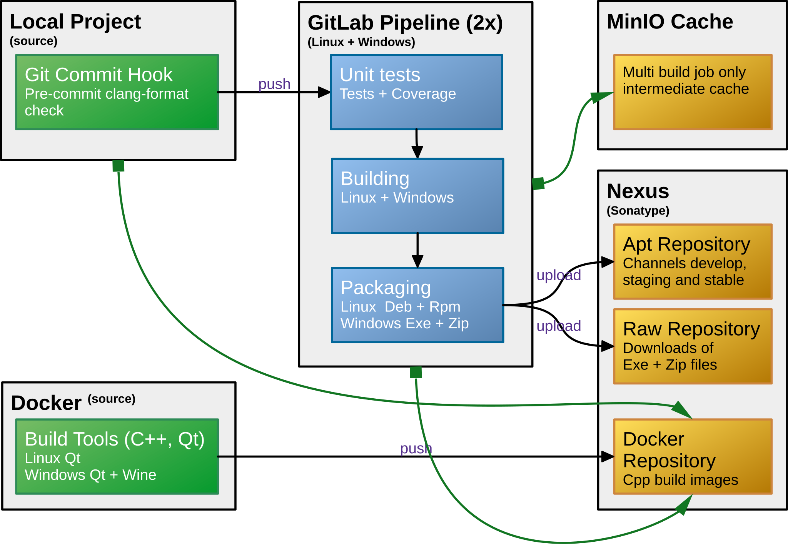
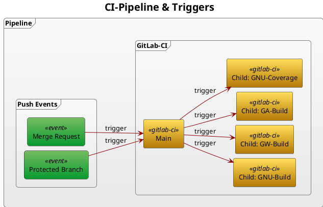

# C++/Qt DevOps Template Project

## Introduction

This project is to test the [CMake build repository](https://github.com/Scanframe/sf-cmake "Link to GitHub")
(git-module) and GitLab's CI/CD-pipeline with a **hello-world** (CLI) and **hello-world-qt** (GUI) C++ applications.

Both applications can be built from Linux (x86_64, aarch64) and from Windows (x86_64) using several toolchains
for cross-compiling even MSVC using Linux-Wine in a Docker container.

The project includes [Catch2](https://github.com/catchorg/Catch2) and [GoogleTest](https://github.com/google/googletest)
unittest-frameworks.

The application has a shared library and is built using CMake and its presets and a build script
to simplify pipeline configurations for building, testing, and packaging.

The Gitlab-Runners use Docker containers for builds, and the runner is also a container itself.
Runners are using a self-hosted caching service/server (MinIO) for caching between jobs across
different hosts machines/containers when build stages are separated in steps depending on the
child pipeline configuration.

The used Docker containers are stored on a self-hosted Docker-repository and deployment on a
self-hosted apt-repository and for Windows a raw-repository.



Links: [GitLab](https://about.gitlab.com/), 
[CMake](https://cmake.org/), 
[Qt-Framework](https://www.qt.io/product/framework),
[Doxygen](https://www.doxygen.nl/),
[Graphiz](https://graphviz.org/),
[Docker](https://www.docker.com/),
[MinIO](https://min.io/),
[Sonatype Nexus](https://www.sonatype.com/),
[CLion](https://www.jetbrains.com/clion/)

Repositories: [sf-docker-runner](https://github.com/Scanframe/sf-docker-runner), 
[sf-cmake](https://github.com/Scanframe/sf-cmake), 
[Catch2](https://github.com/catchorg/Catch2),
[GoogleTest](https://github.com/google/googletest)


## Python Script for Building the Project

The script `./build.py` is a CMake preset helper that reads `CMakePresets.json`/`CMakeUserPresets.json`,
sets toolchain environments from preset metadata, and runs configure/build/test/package or full workflows.
It supports interactive preset selection, non-interactive preset execution, and running inside Docker or
Wine when needed. Wine is used to compile with MSVC and is also available inside the Docker images.
Supported host platforms are Linux (native and cross-compile) and Windows.

| Host OS                | Target OS/Arch                | Preset family       |
|------------------------|-------------------------------|---------------------|
| Linux (x86_64)         | Linux x86_64 (native)         | `gnu-*`             |
| Linux (aarch64)        | Linux aarch64 (native)        | `gnu-*`             |
| Linux (x86_64)         | Linux aarch64 (cross)         | `ga-*`              |
| Linux (x86_64)         | Windows x86_64 (cross + Wine) | `gw-*`              |
| Windows (x86_64)       | Windows x86_64                | `mingw-*`, `msvc-*` |
| Docker (Linux x86_64)  | Linux x86_64                  | `gnu-*`             |
| Docker (Linux x86_64)  | Windows x86_64 (cross + Wine) | `gw-*`              |
| Docker (Linux aarch64) | Linux aarch64 (cross)         | `ga-*`              |

| Preset family | Compiler/toolchain                                        |
|---------------|-----------------------------------------------------------|
| `gnu-*`       | Native GNU (gcc/g++)                                      |
| `ga-*`        | GNU Arm (aarch64 cross)                                   |
| `gw-*`        | MinGW-w64 (Linux cross to Windows, with Wine for testing) |
| `mingw-*`     | MinGW-w64 (Windows native)                                |
| `msvc-*`      | MSVC (Windows 10/11, Wine64)                              |

The script is also used to run in the CI/CD-pipeline using a Docker container.

> Information on the script is found in the [build.md](cmake/lib/doc/build.md "Link to script.") file.

## JetBrains IDE's

> See the page on: [Jetbrains' CLion](doc/jetbrains-clion.md)

Next is a table of all combinations possible using JetBrains products for development.  
Some of the next table columns and values are explained:

* **IDE**: Integrated Development Environment
* **CLion**: [JetBrains C++ IDE](https://www.jetbrains.com/clion/)
* **Gateway/SSH**: [JetBrains Gateway](https://www.jetbrains.com/remote-development/gateway/) over SSH using CLion.
* **Target OS**: Operating system.
* **Arch**: Architecture of the build system.
* **Unittest**: Perform unitest (no debug) from the IDE.
* **Debug**: Debug from the IDE without additional configuration.
* **Toolchain**: The toolchain used.
* **Coverage**: Able to perform coverage and produce a report (target `document`).
* **SSH**: On a remote machine the `./build.py docker sshd` is executed opening port `8022`.

| IDE         | Host OS       |  Arch  | Toolchain           | Target OS     | Unittest | Debug | Coverage |
|-------------|:--------------|:------:|:--------------------|:--------------|:--------:|:-----:|:--------:|
| CLion       | Windows 10/11 | x86_64 | mingw-x86_64        | Windows 10/11 |   yes    |  yes  |  maybe   |
| CLion       | Windows 10/11 | x86_64 | msvc-x86_64         | Windows 10/11 |   yes    |  yes  |  maybe   |
| CLion       | Ubuntu 24.04  | x86_64 | gnu-x86_64          | Ubuntu 24.04  |   yes    |  yes  |   yes    |
| CLion       | Ubuntu 24.04  | x86_64 | gnu-aarch64         | Ubuntu 24.04  |   yes    |  yes  |   yes    |
| CLion       | Ubuntu 24.04  | x86_64 | mingw-x86_64        | Ubuntu 24.04  |   yes    |  no*  |   yes    |
| CLion       | Linux         | x86_64 | Docker/gnu-x86_64   | Ubuntu 24.04  |   yes    |  no*  |   yes    |
| CLion       | Linux         | x86_64 | Docker/mingw-x86_64 | Windows 10/11 |   yes    |  no*  |  maybe   |
| CLion       | Linux         | x86_64 | Docker/gnu-aarch64  | Ubuntu 24.04  |   yes    |  no*  |   yes    |
| Gateway/SSH | any           | x86_64 | Docker/gnu-x86_64   | Ubuntu 24.04  |   yes    |  yes  |   yes    |
| Gateway/SSH | any           | x86_64 | Docker/mingw-x86_64 | Windows 10/11 |   yes    |  yes  |  maybe   |
| Gateway/SSH | any           | x86_64 | Docker/gnu-aarch64  | Ubuntu 24.04  |   yes    |  yes  |   yes    |

> **`no*`** CLion debugging withing a Docker toolchain is possible starting up `gdbserver` and  
> configuring a CLion target for remote `gdb` usage and mapping source paths.

## Cloning

After cloning the Git repository is to be initialized using the script [init-repo.sh](init-repo.sh "Link to script.")
facilitates retrieving submodules and URL when cloned from GitHub.
Fixes the symlinks for Windows/Cygwin which requires Cygwin to be installed using one of the following scripts.

### Cygwin on Windows Installation

Cygwin automatic installation script/command using PowerShell.

```shell
powershell -Command "Invoke-Expression(Invoke-WebRequest ^
  -Uri 'https://raw.githubusercontent.com/Scanframe/sf-cygwin-bin/master/install-cygwin.ps1' -UseBasicParsing).Content"
```

```shell
powershell -Command "Invoke-Expression(Invoke-WebRequest ^
  -Uri 'https://git.scanframe.com/shared/bin-bash/-/raw/master/install-cygwin.ps1' -UseBasicParsing).Content"
```

### Clone, Initialize, Build, Test & Package

The project uses the CMake workflow, which is a high-level preset that defines a sequence of configuration,
build, and test steps in a single preset. Introduced in CMake v3.24, workflow presets allow users to streamline
multi-stage operations within a project, reducing manual commands. They reference **configuration**, **build**, and
**test** presets, enabling consistent and repeatable workflows.

#### Cloning (Linux/Windows)

For any OS the following commands are used to clone the repository.

```shell
git clone "https://git.scanframe.com/shared/devops.git" trial-devops
# Fixes symlinks in the repository on Windows/Cygwin.
./init-repo.sh
```

#### Setting up Build Tools

For Linux the following commands are used to install the required build tools.

```shell
./build.py install --required lnx # Native compiler and tools for Linux.
./build.py install --required win # Mingw cross-compiler for Windows and requires also 'lnx'.
./build.py install --required arm # Build tools for cross-compiling aarch64 and requires also 'lnx'.
```

## Docker Build Image

The Docker image used for the CI/CD-pipeline en also for compiling in [CLion](https://www.jetbrains.com/clion/) is
configured by the in the GitHub [`sf-docker-runner`](https://github.com/Scanframe/sf-docker-runner) repository bash
script `cpp-builder.sh` and `cpp-builder/cpp.Dockerfile`.  
The bash-script assembles all files needed to create a self-hosted
[Sonatype Nexus server](https://nexus.scanframe.com/#browse/browse:docker-image).

Clone the repository, execute the script, and view its sub-commands.
It requires pre-compiled Qt libraries which is done using the `build-qt-lib.sh` shell script.

### Available Prebuild Docker Images

| Image                                            | OS           | Architecture | Qt      |
|--------------------------------------------------|--------------|--------------|---------|
| `nexus.scanframe.com/amd64/gnu-cpp:24.04`        | Ubuntu 24.04 | x86_64       | n/a     |
| `nexus.scanframe.com/arm64/gnu-cpp:24.04`        | Ubuntu 24.04 | aarch64      | n/a     |
| `nexus.scanframe.com/amd64/gnu-cpp:24.04-6.8.1`  | Ubuntu 24.04 | x86_64       | v6.8.1  |
| `nexus.scanframe.com/arm64/gnu-cpp:24.04-6.8.1`  | Ubuntu 24.04 | aarch64      | v6.8.1  |
| `nexus.scanframe.com/amd64/gnu-cpp:24.04-6.10.1` | Ubuntu 24.04 | x86_64       | v6.10.1 |
| `nexus.scanframe.com/arm64/gnu-cpp:24.04-6.10.1` | Ubuntu 24.04 | aarch64      | v6.10.1 |

The image without the Qt framework is also used to compile the Linux Qt framework for the image with a Qt framework.

The image contains all necessary packages for all build targets, including documents), and each
of them is listed here with their versions.

## The C++ Application Source

### Applications & Library

The application source is located in this repository.  
The generic '**hello-world**' console application in [`gen/main.cpp`](src/cli/main.cpp).  
The Qt cross-platform '**hello-world-qt**' GUI-application in [`qt/main.cpp`](./src/qt/main.cpp).  
The cross-platform '**hello-lib**' shared/dynamic/library in [`hwl/src/main.cpp`](./src/hwl/src/hello.cpp).

### CMake Generic C++ Support Library

The CMake Linux package contains more than the `cmake` executable.

| App   | Description                                                                                                                                                                                                                                                                                  |
|-------|----------------------------------------------------------------------------------------------------------------------------------------------------------------------------------------------------------------------------------------------------------------------------------------------|
| CMake | CMake is an open-source, cross-platform build system. It uses configuration files (CMakeLists.txt) to generate native build scripts for various platforms and compilers. CMake simplifies the build process by providing a consistent interface for managing complex build configurations.   |
| CTest | CTest is a testing tool that integrates with CMake. It allows developers to define and run tests for their CMake-based projects. CTest can execute tests in parallel, generate test reports, and integrate with Continuous Integration (CI) systems for automated testing.                   |
| CPack | CPack is a packaging tool designed to create distribution packages for software projects built with CMake. It can generate package formats such as DEB, RPM, NSIS, and ZIP. CPack simplifies the process of creating installable packages for different operating systems and distributions. |

To allow reuse of scripts for the ease of usage, a library [sf-cmake](https://github.com/Scanframe/sf-cmake) is created
and used as a Git-submodule.

#### Unittest Frameworks

To make it more challenging, both **Catch2** and **Googletest** unittest framework libraries
are cloned and imported as an example.
The test application sources are located in [`./src/tests`](./src/tests).

#### Doxygen Manual/Document Generator

The `cmake/lib/SfDoxygenConfig.cmake` package adds a function `Sf_AddDoxygenDocumentation()` which in its turn adds a
manual target.

Look at the [Doxygen](https://www.doxygen.nl/) website for the syntax in C++ header comment blocks or Markdown files.

#### Code Format Checking with Clang-Format

To enable format check before a commit, modify or add the script `.git/hooks/pre-commit` with the following content.
It calls the [check-format.sh](./check-format.sh) script which in directly calls
the [`clang-format.sh`](https://github.com/Scanframe/sf-cmake/blob/main/bin/clang-format.sh) script
from the CMake support library. It also checks if it is a commit to the main or master branch and prevents it.

```bash
#!/bin/bash

# Redirect output to stderr.
exec 1>&2
# Get the branch name.
branch="$(git rev-parse --abbrev-ref HEAD)"
# Check if it is 'main' and prevent a commit on it.
if [[ "${branch}" == "main" || "${branch}" == "master" ]]; then
	echo "You can't commit directly to the '${branch}' branch!"
	exit 1
fi

# When the file 'check-format.sh' exists call it to check if the formatting is correct.
if [[ -f check-format.sh ]]; then
	if ! ./check-format.sh; then
		echo "Source is not formatted correctly!"
		exit 1
	fi
fi
```

This same script is used in the main pipeline configuration script [`main.gitlab-ci.yml`](.gitlab/main.gitlab-ci.yml)
in the job named '**check-env**'.  
So when the format is incorrect, the pipeline fails.

## CI/CD Pipeline Configuration

The CI/CD Pipeline configuration has a main [`main.gitlab-ci.yml`](.gitlab/main.gitlab-ci.yml) file which triggers a  
child-pipeline [`build-single.gitlab-ci.yml`](.gitlab/main.gitlab-ci.yml) twice.  
Respectively **Linux** and **Windows** but having different variable assignments passed from the main pipeline.  
The [`coverage.gitlab-ci.yml`](.gitlab/coverage.gitlab-ci.yml) is triggert once.

The `SF_SIGNAL` variable is set in GitLab for the project.

| Value  | Description                                                                            |
|--------|----------------------------------------------------------------------------------------|
| skip   | Do not trigger any pipelines.                                                          |
| test   | Tests the caching and artifacts mechanism.                                             |
| deploy | Allows testing manual deployment of packages where child pipelines are manual as well. |
|        | When left empty or not defined the pipeline runs normal.                               |



## MinIO Cache Server

The Docker way is to use image `minio-server` and `minio-mc` respectively for service and control console.  
For using Docker a script [`minio.sh`](https://github.com/Scanframe/sf-docker-runner/blob/main/minio.sh) is created to
simplify it in
the [`sf-docker-runner`](https://github.com/Scanframe/sf-docker-runner) repository.  
To install a MinIO service from scratch using a Debian package is described in
the [wiki-page](https://wiki.scanframe.com/en/Configuration/Linux/minio-installation).

## Sonatype Nexus

To configure an APT-repository on a Sonatype Nexus server is described in
this [wiki-page](https://wiki.scanframe.com/en/Configuration/Linux/nexus-apt-hosted-repo "Link to Scanframe WikiJS.").  
For uploading files to a Nexus repository is the [`upload-nexus.sh`](cmake/lib/bin/upload-nexus.sh) script.

## GitLab-Runner with Docker

To run a GitLab-Runner service using Docker, use image `gitlab/gitlab-runner:latest`.  
For using Docker a script [`gitlab-runner.sh`](https://github.com/Scanframe/sf-docker-runner/blob/main/gitlab-runner.sh)
is created.
The script sets all the needed Docker options required by the 'C++ Build Image' (`gnu-cpp:dev`) to
have fuse available for `bindfs` `fuze-zip` and mounting it in the [
`sf-docker-runner`](https://github.com/Scanframe/sf-docker-runner) repository.

## Gitlab Issues

### Child Coverage Report

A child pipeline [(`linux-gcov`)](.gitlab/main.gitlab-ci.yml) cannot not report coverage to GitLab.
The workaround is storing the coverage report, which is a text file on the Nexus server in a temporary location,
in the child pipeline's job.
In the main pipeline a job [(`report-coverage`)](.gitlab/main.gitlab-ci.yml) retrieves the report and
outputs it so GitLab picks it up from there using the `coverage` in job configuration (
`coverage: /^\s*lines:\s*\d+.\d+\%/`).

A [GitLab issue 363557](https://gitlab.com/gitlab-org/gitlab/-/issues/363557 "Issue link.") has been created but is not
resolved jet.
